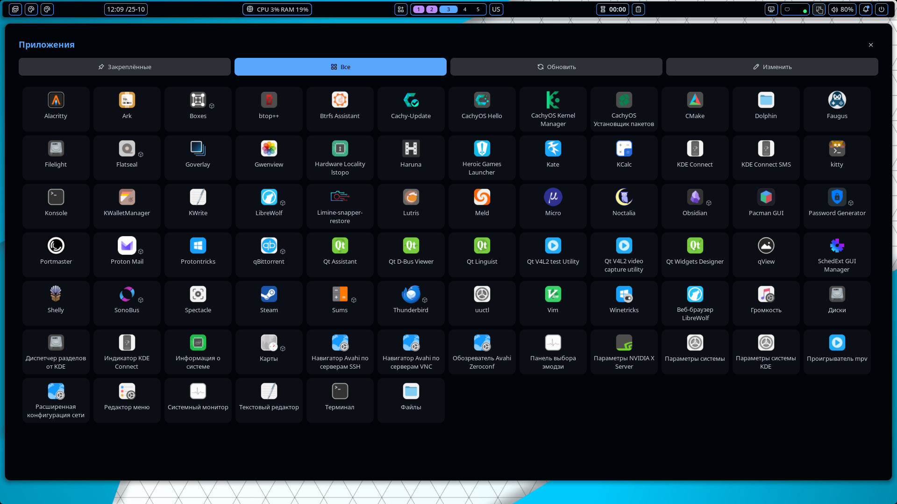

# App Launcher

A launcher panel with a fixed size, **Pinned / All** tabs and a scrollable app grid. There is no search and no
automatic refresh: it is a plain grid that opens with one click or one key.




## Plugin

| | |
|---|---|
| Plugin id | `xrtsx/app-launcher` |
| Bar widget | `xrtsx/app-launcher:button` |
| Panels | `launcher` (900x780), `launcher_medium` (1100x880), `launcher_large` (1300x980), `launcher_xl` (1900x980) |
| Service | `xrtsx/app-launcher:indexer` |

## Usage

1. Enable the plugin: `noctalia msg plugins enable xrtsx/app-launcher` (or Settings -> Plugins).
2. Add the **App Launcher** widget to your bar. A click opens the panel in the size chosen in the plugin settings.
3. Or open a panel directly:

```
noctalia msg panel-toggle xrtsx/app-launcher:launcher
noctalia msg panel-toggle xrtsx/app-launcher:launcher_medium
noctalia msg panel-toggle xrtsx/app-launcher:launcher_large
noctalia msg panel-toggle xrtsx/app-launcher:launcher_xl
```

Hyprland keybind example (use one line per key; `SUPER, A` is only an example):

```
bind = SUPER, A, exec, noctalia msg panel-toggle xrtsx/app-launcher:launcher_xl
```

In the panel:
- **Pinned** and **All** switch the grid; the grid scrolls vertically.
- **Refresh** re-reads the installed apps. Use it after installing a program.
- **Edit** switches to pin mode: click an app to pin or unpin it, then press **Done**.
- Flatpak apps get a small cube badge next to the icon.

## Settings

| Setting | Default | Description |
|---|---|---|
| Icon size | `48` | App icon size in pixels (24-128) |
| Columns | `6` | Columns in the grid (2-12). Around 10-12 suits the extra large size |
| Window size | Small | Small / Medium / Large / Extra large. Applied the next time the panel opens |

## Requirements

None. The plugin uses only the Noctalia plugin API and does not run external commands.

## IPC

Re-read the installed apps from a terminal or a keybind:

```
noctalia msg plugin xrtsx/app-launcher:indexer all refresh
```

## Notes

- **Reads:** `.desktop` files from `~/.local/share/applications/`, `/usr/local/share/applications/`,
  `/usr/share/applications/` and the user and system Flatpak export directories. Entries with `NoDisplay` or `Hidden`
  are skipped.
- **Writes:** `pinned.json` in the plugin directory, written when you pin or unpin an app.
- **Processes:** launching an app starts its `Exec` command (in a terminal for `Terminal=true` apps), the same way a
  desktop launcher does. No other processes are started.
- **Network:** none.
- The indexer does its work a few apps at a time so a call never exceeds the per-call CPU budget.
- `panel.luau` ends with a block of `launch_1` ... `launch_400` functions. Click handlers are given to the host by
  global function name, and globals cannot be created at runtime, so they are declared statically. The panel shows at
  most 400 apps per tab.
- Only Flatpak apps get a source badge; AUR or other packages are not marked.
